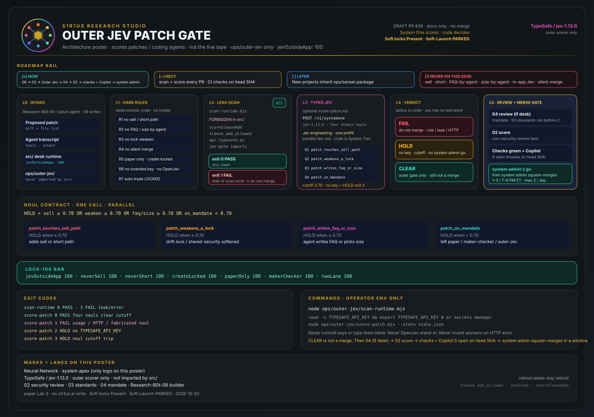
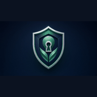
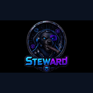
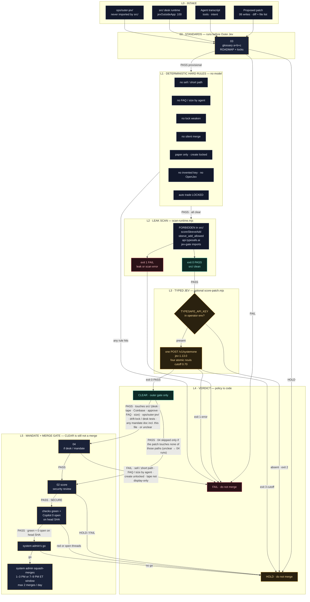
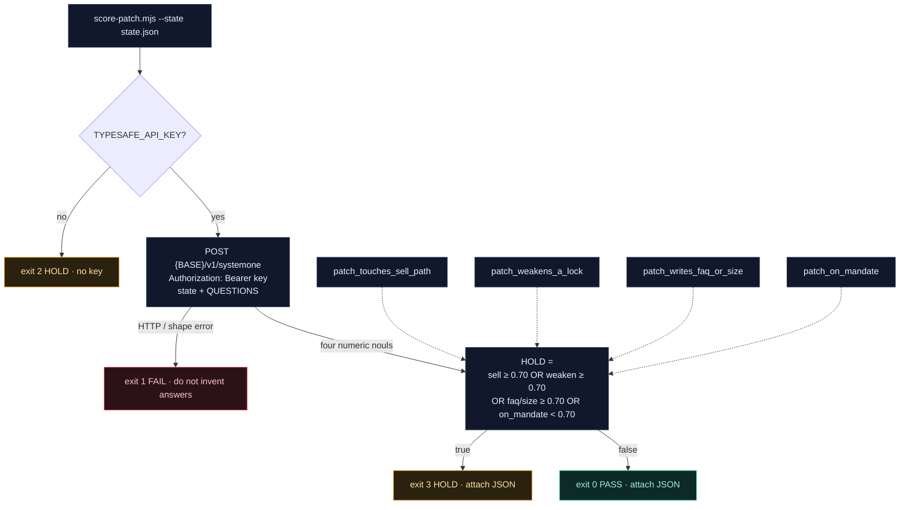

# 04 — Outer Jev patch gate

Jev scores **patches / coding agents**, not the live tape. Lives only under `ops/outer-jev/`. Hard rules run **before** any model. Optional scorer: `score-patch.mjs` (PR #10, `5346feb`). No OpenJev. Not imported by `src/`.

Canonical handoff sequence stays in [07-lab3-bot-workflow](./07-lab3-bot-workflow.md). This file is the architecture.

Status: Soft locks Present · Soft-Launch PARKED

---

## Studio poster — system mark + roadmap rail

GitHub-renderable control-plane poster. Uses the **official Neural Network system mark**, the text label TypeSafe / `jev-1.13.0` for the outer scorer (no scorer logo), bots by number only (02 / 03 / 04 / 06), and the [ROADMAP](../ROADMAP.md) Now / Next / Later / Never rail.



Official logo strip (2026-09-27 marks; cited, not re-authored):

<p>






</p>

| Mark | Role on this gate |
| --- | --- |
| **Neural Network** | System apex. Oversight / recursive engineer. Not a live-tape voter. |
| **TypeSafe / `jev-1.13.0`** | Outer scorer only (`jev-1.13.0` / System One). Code is System Two. |
| **02** | Own security-review lane: scores the PR (SECURE / HOLD / FAIL) after the outer gate. Not a hard-rule layer; L1 is deterministic code, no model. |
| **03** | Standards lane (glossary a+b+c) — runs first, before Outer Jev L1–L4. Standards, not merge. |
| **04** | L5 mandate / inventory if the patch touches the desk. |
| **06** | L0 proposer / builder (06 writes). Does not self-merge. |
| **7-B0T** | Purchase-call / CLIP board (SIM-locked). Desk context only. Gate still never sells, never sizes, never writes FAQ. |
| **8-B0T** | Maker-checker propose lane. Desk context only. Gate still never sells, never sizes, never writes FAQ. |
| **9-B0T** | ≤30% paper-profit sleeve, 1–30% risk slider, user Approve/Deny. Desk context only. Gate still never sells, never sizes, never writes FAQ. |

Quality Bot unnumbered; desk context only.

Jev engineering reference (official X, not a product import): System One is a parallel decision primitive — state + typed questions in, nouls out, code branches. Do not plug Jev into high-level product decisions inside `src/`. Program the gate.

---

## Control plane

Six planes. Fail-closed. Policy is code — Jev never has the last word.



Fail-closed: **FAIL** and **HOLD** are terminal (do not merge) and have no onward edge. Only arrows labeled **PASS** (or the system admin's **go**) move a patch forward. Lane order matches [Flow 07](./07-lab3-bot-workflow.md) and [INDEX](./INDEX.md): 03 runs first, then Outer Jev (L1–L4), then 04 (if desk), 02, checks + Copilot, and the system admin. 04 path rule: 04 always runs if the patch touches `src/` (desk, tape, Coinbase, approve, FAQ or size), `ops/outer-jev/`, the drift-lock or desk tests, or any doc that states the mandate (this file included). When unclear, 04 runs. A 04 FAIL (sell or short path, FAQ or size set by an agent, create left unlocked, tape not display-only) stops the flow, and so does a 03 FAIL or HOLD.

---

## Execution — four nouls, one call



| Noul | HOLD when | Means |
| --- | --- | --- |
| `patch_touches_sell_path` | ≥ 0.70 | Patch adds or opens a sell or short path |
| `patch_weakens_a_lock` | ≥ 0.70 | drift-lock or shared-security lock is softened |
| `patch_writes_faq_or_size` | ≥ 0.70 | Agent writes FAQ copy or picks a trade size |
| `patch_on_mandate` | **< 0.70** | Patch left paper accumulate / maker-checker / outer-Jev mandate |

Cutoff `0.70` is code in `ops/outer-jev/score-patch.mjs`. Jev returns nouls. Code decides.

---

## Exit codes

| Tool | Exit | Meaning |
| --- | --- | --- |
| `scan-runtime.mjs` | 0 | PASS — no in-app Jev in `src/` |
| `scan-runtime.mjs` | 1 | FAIL — leak or scan error |
| `score-patch.mjs` | 0 | PASS — four nouls clear cutoff |
| `score-patch.mjs` | 1 | Error — usage / HTTP / fabricated noul |
| `score-patch.mjs` | 2 | HOLD — no `TYPESAFE_API_KEY` |
| `score-patch.mjs` | 3 | HOLD — noul cutoff trip |

---

## Hard rules (always, before any model)

- Never add a sell tool
- Never write FAQ from an agent
- Never pick a trade size
- Never weaken drift-lock / shared-security locks
- Never merge to main without the system admin's go: 06 proposes → 03 → Outer Jev → 04 (if desk) → 02 score → checks green + Copilot 0 open on head SHA → system admin squash-merges in a merge window (1–3 PM or 7–9 PM ET, max 2 / day)
- Never sell, never short, Coinbase create locked, paper only
- Auto trade LOCKED
- Never invent keys; never OpenJev stand-in

## Commands

```bash
node ops/outer-jev/scan-runtime.mjs

# optional — operator env only; never commit, never put a key on the command line
# export it from your secrets manager, or type it hidden (stays out of shell history):
read -s TYPESAFE_API_KEY && export TYPESAFE_API_KEY
node ops/outer-jev/score-patch.mjs --state state.json

# optional gateway (same System One shape):
# TYPESAFE_BASE_URL=https://openrouter.ai/api TYPESAFE_API_KEY=$OPENROUTER_API_KEY \
#   node ops/outer-jev/score-patch.mjs --state state.json
```

Key location: operator env only — never commit. See `ops/outer-jev/CONFIG.md`, `QUESTIONS.md`, and [INSTRUMENTATION.md](../INSTRUMENTATION.md).

Retired in-app labels (do not restore): `sleeve_add_allowed`, `jevScope`, `scoreSleeveAdd`, desk Jev panel.
