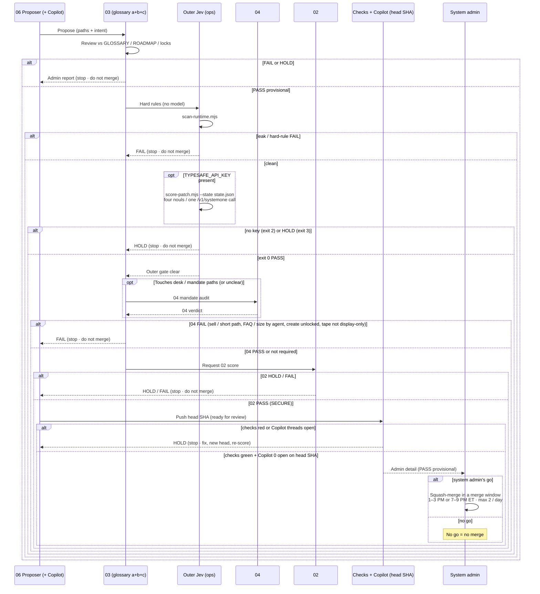
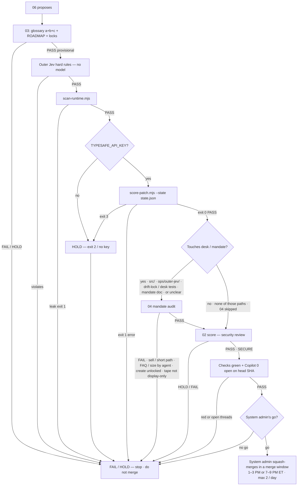

# 07 — Lab 3 bot workflow (canonical)

Primary handoff for Lab 3 paper desk patches. Cite [GLOSSARY.md](../GLOSSARY.md) (a+b+c), [BOT-INTERFACE.md](../BOT-INTERFACE.md), and [`ops/outer-jev/`](../../outer-jev/). Skill: **lab-3-sensei-workflow**. No OpenJev. No merge without the system admin's go.

Canonical gate (same as [INDEX](./INDEX.md) and the [04 hard rules](./04-outer-jev-patch-gate.md#hard-rules-always-before-outer-jev--any-scoring-model)): 06 proposes → 03 → Outer Jev (`scan-runtime.mjs` + optional `score-patch.mjs`) → 04 (if desk) → 02 score → checks green + Copilot 0 open on head SHA → system admin squash-merges in a merge window (1–3 PM or 7–9 PM ET, max 2 / day). Any FAIL or HOLD stops the flow: do not merge.

04 path rule (same as [04](./04-outer-jev-patch-gate.md#control-plane)): 04 always runs if the patch touches `src/` (desk, tape, Coinbase, approve, FAQ or size), `ops/outer-jev/`, the drift-lock or desk tests, or any doc that states the mandate. When unclear, 04 runs.

## Sequence



## Flowchart



## Cite

| Step | Artifact |
| --- | --- |
| Standards | [GLOSSARY.md](../GLOSSARY.md) · [ROADMAP.md](../ROADMAP.md) |
| Handoff | [BOT-INTERFACE.md](../BOT-INTERFACE.md) · skill `lab-3-sensei-workflow` |
| Outer Jev | [04-outer-jev-patch-gate](./04-outer-jev-patch-gate.md) · [`scan-runtime.mjs`](../../outer-jev/scan-runtime.mjs) · [`score-patch.mjs`](../../outer-jev/score-patch.mjs) (PR #10, `5346feb`) · [QUESTIONS.md](../../outer-jev/QUESTIONS.md) · [CONFIG.md](../../outer-jev/CONFIG.md) |
| Reports / exits | [ADMIN-DETAIL.md](../ADMIN-DETAIL.md) · [INSTRUMENTATION.md](../INSTRUMENTATION.md) |
| Search terms | [SEARCH-SCHEMA.md](../SEARCH-SCHEMA.md) |

**Commands**

```bash
node ops/outer-jev/scan-runtime.mjs
# optional — operator env only; never commit, never invent, never OpenJev,
# never put a key on the command line. Export it from your secrets manager,
# or type it hidden (stays out of shell history):
read -s TYPESAFE_API_KEY && export TYPESAFE_API_KEY
node ops/outer-jev/score-patch.mjs --state state.json
# optional gateway (key already exported in the environment, never inline):
# export TYPESAFE_BASE_URL=https://openrouter.ai/api
# node ops/outer-jev/score-patch.mjs --state state.json
```
